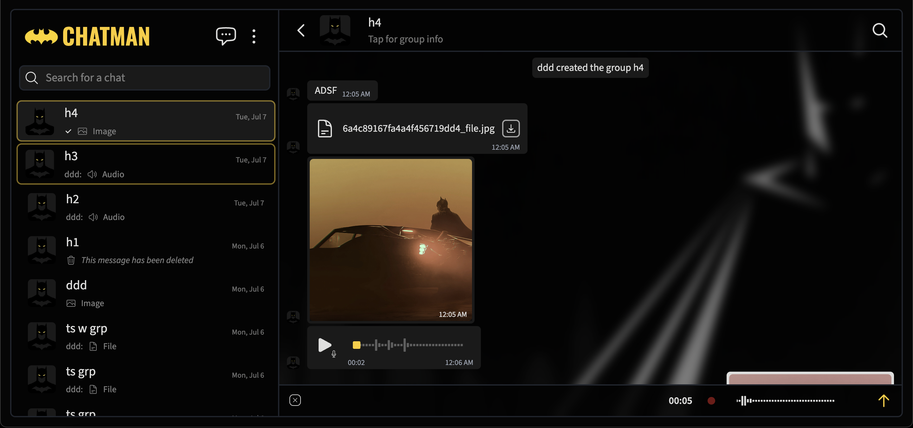

# CHATMAN

A real-time chat application built with the MERN stack (MongoDB, Express, React, Node.js) and Redis. The focus of the project is on reliable message delivery: ordering, deduplication, and offline handling.




## Features

- Real-time one-to-one and group messaging
- **Message sequencing** so messages appear in the correct order, using Redis and client-side logic
- **Message deduplication** on the client, so retries and reconnects never show the same message twice
- **Offline delivery:** undelivered messages are queued and persisted in MongoDB until the recipient receives them
- **Read receipts**
- **Presence tracking:** online status and last seen, backed by Redis and MongoDB
- **Local-first message storage:** messages are kept on the device in IndexedDB
- **Image handling:** client-side compression for profile photos and images sent in chat
- Redis caching

## Tech Stack

| Layer | Technology |
|---|---|
| Frontend | React (JavaScript) |
| Backend | Node.js, Express |
| Real-time | [Socket.IO |
| Database | MongoDB |
| Cache / sequencing / presence | Redis |
| Client storage | IndexedDB |

## How It Works

### Message sequencing
Message metadata has sequence ID stored with last sequence ID stored in chat metadata and on redis when chat is active. Every message gets a new incremented sequence ID from Redis for message ordering

### Deduplication
Deduplication is implemented with message IDs in three levels on the client with FIFO cache, bloom filter and indexedDB check

### Offline delivery
When a recipient is offline, the message is saved in MongoDB and it stays in MongoDB either until message gets delivered to recipient or until 30 days.

### Presence
Presence is tracked with heartbeats from the client. When a heartbeat is missed, the user status is updated to offline with the last online info. This info is also updated to MongoDB. Presence info is stored on Redis for the user that was recently online and then flushed to DB if the user stays offline for a while 

### Local storage
Conversations are stored in the browser's IndexedDB, so history loads from the device. The server keeps messages only until they are delivered.

## Architecture

```
Client (React + IndexedDB)  <--WebSocket-->  Node/Express server  --> Redis (cache, sequencing, presence)
                                                    |
                                                    +--> MongoDB (users, undelivered messages)
```

## Known Limitations

Being upfront about what this project does not do:
- No end-to-end encryption
- No voice or video calls
- No push notifications
- Not a PWA
- Written in JavaScript, not TypeScript
- Redis calls need some optimization

## Roadmap

- [ ] Fix remaining Redis issues
- [ ] Migrate to TypeScript (backend first)
- [ ] Add automated tests for sequencing and deduplication

## What I Learned

The hardest problems to solve for me were, message ordering, deduplication, read receipts without actual push notification implementation, and a bit of struggle with getting infinite scroll for chats right. Things that i would do differently are making the project in typescript to avoid massive debugging time, writing tests alongside building the app, implementing push notifications so that read receipts implementation were more natural, making it a PWA, and probably using other services like rabbitMQ or kafka instead of implementing the read receipts or message queuing more manually. 
